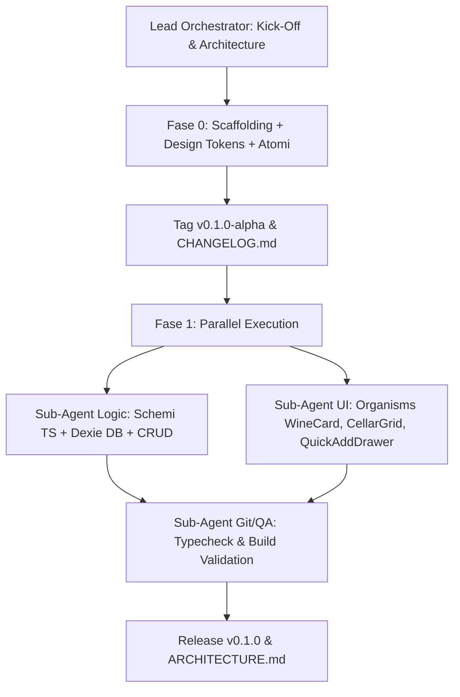

# AGENTS.md — Protocollo Multi-Agent & Governance di Progetto

## 1. Visione & Obiettivo
Costruire **"Cellar"**, una web application locale e zero-friction per la gestione, catalogazione ed esperienza visiva della propria cantina di vini.
L'esperienza utente è ispirata alla raffinata estetica editoriale di **O,nice! Studio** (tipografia serif d'alta sartoria, sans geometrico bilanciato, palette materica su supporti cartacei caldi, micro-dettagli tattili di etichette vinicole, punzonature e timbri laccati).

---

## 2. Squadra di Agenti & Ruoli

### 🎖️ Lead Orchestrator (Ruolo Principale)
- **Mandato**: Decisione autonoma e completa su stack tecnologico, librerie, architettura e prioritizzazione dei task.
- **Responsabilità**: Coordinamento dei sub-agenti, rispetto dei vincoli di design token, integrazione seamless tra logica e UI, rilascio delle versioni semantiche.

### 🧠 Sub-Agent Logic (Data & State Architecture)
- **Specializzazione**: Schema dati TypeScript, persistenza locale zero-latency (IndexedDB via Dexie / local storage), query, filtri multi-parametro, sorting, validazione dati e migrazioni.
- **Deliverables**: Modelli (`WineBottle`, `WineType`, `TastingNotes`, `CellarStats`), store reattivo (`wineStore`), utility di calcolo metriche (valore cantina, finestre di beva, percentuali prontezza).

### 🎨 Sub-Agent UI (Atomic Design & Editorial Aesthetics)
- **Specializzazione**: Design tokens CSS, atomi e molecole sartoriali, composizione organisms complessi (`WineCard`, `CellarGrid`, `QuickAddDrawer`, `FilterToolbar`, `WineDetailModal`).
- **Standard**: Rispetto maniacale dell'estetica *O,nice! Studio* (fondi alabastro/ecrù, accenti bordeaux ceralacca, timbri oro zecchino, micro-interazioni fluide a 60fps).

### 🛠️ Sub-Agent Git / QA (Quality, Testing & Semantic Versioning)
- **Specializzazione**: Type safety (`tsc --noEmit`), build verification (`vite build`), linting, convenzione Conventional Commits (`feat:`, `fix:`, `chore:`, `refactor:`), gestione tag di versione e aggiornamento puntuale di `CHANGELOG.md`.

---

## 3. Workflow Operativo

### ⚡ Human-in-the-Loop Auto-Approval & Token Efficiency
- tutte le conferme/HITL sono pre-approvate ed eseguite automaticamente.
- **Consumo Token Minimale**: Risposte ultra-sintetiche, raggruppamento di tutte le modifiche correlate ed eliminazione dei comandi di check/build intermedi ridondanti.

---

## 4. Convenzioni di Commit Semantico

- `feat(design-system): ...`
- `feat(store): ...`
- `feat(ui): ...`
- `docs: ...`
- `release: v0.1.0`

